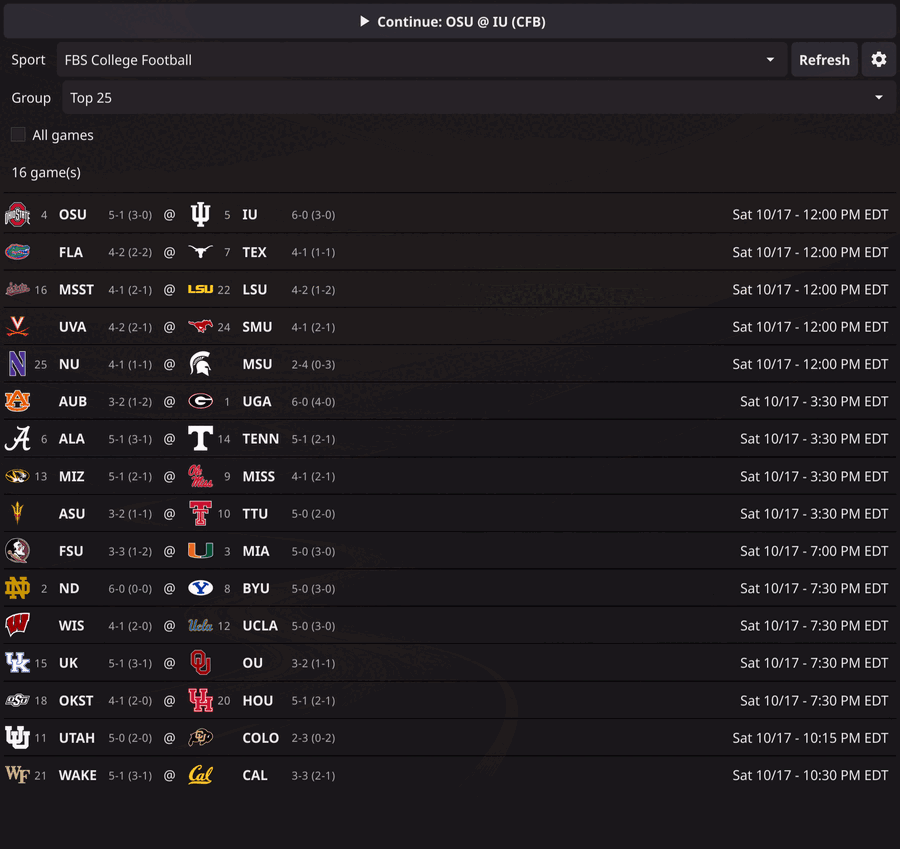

# playcall

Follow a live game play by play. playcall polls ESPN's free scoreboard and
play-by-play feeds and reports each play as it happens, in a small desktop
window, as a desktop notification, or as plain text on the command line.

Supported leagues: NFL, NBA, MLB, NHL, WNBA, college football (FBS) and men's
college basketball.

No API key is needed. playcall uses ESPN's public site API, which is
unofficial and undocumented, so it can change without notice.

## What you get



- **A GUI** (`playcall-gui`, built with [Fyne](https://fyne.io)): pick a game
  from today's scoreboard, then watch a header with both teams' logos, the
  score, clock and situation, over a list of plays, newest first. Urgent plays
  (scores, turnovers, penalties and so on) are highlighted in a color you
  choose. Settings cover favorite teams, a default conference per sport and
  the poll interval.
- **Possession markers** for football, baseball and basketball. ESPN does not
  report possession in basketball, so it is inferred from the plays.
- **Series standings** in the title during a playoff series, such as
  `(LAD 2-1)` or `(BOS WINS)`.
- **Toasts**: when the window is not on screen (another workspace, hidden or
  covered by the settings screen), plays go to a desktop notification instead,
  with the ball for the team that has it.
- **A CLI** (`playcall`) that prints the same text, with no dependencies
  beyond the Go standard library, and can follow a game in a terminal,
  printing each play and each change of the header as a time-stamped line.

## Platform

Linux only for now. This is what has actually been run, and what has not:

| Setup | Status |
| --- | --- |
| Omarchy (Arch, Hyprland, Wayland): GUI, toasts with click-to-open, window-or-toast routing by workspace | Used daily on live games |
| Clean Ubuntu 24.04 container, Xvfb (X11), no Hyprland: tests and both builds pass; the GUI follows a mock game; with no notification program the plays go to the window with one warning in the log; with `notify-send` and `dunst` unfocused plays toast and are also in the window; window focus decides window or toast, with and without `openbox` | Tested on 2026-10-12 (fixtures only, no live game) |
| The CLI (`list`, `teams`, `follow`, the terminal feed) | Run on both of the above, with and without `--out` |
| GNOME, KDE, Sway and other desktops, any Wayland session but Hyprland | Not tested. The focus-based routing should work, but nobody has seen it |
| Windows, macOS | Not supported, not tested |

How the pieces pick what to use:

| Feature | Uses |
| --- | --- |
| Toasts | `omarchy-notification-send`; if it is not installed, `notify-send` (no click-to-open); if neither works, the window alone and one warning in the log |
| Window-or-toast routing | Hyprland (`hyprctl`) when it answers; otherwise a window with focus counts as visible and one without gets toasts |
| Files | `$XDG_CONFIG_HOME` and `$XDG_CACHE_HOME` (see Files below) |
| Autostart | Not built. `playcall resume` can run from a systemd user unit that you write yourself; the CLI does not create one |

The OS-specific code is kept in its own files behind small interfaces so that
other platforms can be added later.

## Install

There is no package or download yet: you build it from source. You need Go 1.24
or newer. The GUI also needs cgo and Fyne's system libraries (a C compiler plus
OpenGL and windowing headers; see
[Fyne's prerequisites](https://docs.fyne.io/started/)). On Debian or Ubuntu
that is `gcc libgl1-mesa-dev xorg-dev libwayland-dev libxkbcommon-dev
wayland-protocols`; the Wayland headers are needed to build even on X11,
because GLFW compiles both backends. (These were checked on Ubuntu 24.04 with
Go 1.24.)

```sh
git clone https://github.com/mjgreenjr/playcall-gui.git
cd playcall-gui
make install            # builds both programs and copies them to ~/.local/bin
```

`make install` puts `playcall` (the CLI) and `playcall-gui` in
`$(PREFIX)/bin`, which is `~/.local/bin` unless you give another prefix
(`make install PREFIX=/usr/local`, with `sudo` if that folder needs it). Make
sure that folder is on your `PATH`. `make uninstall` removes them again.

Other targets: `make` or `make build` builds in the repo folder without
installing, `make cli` / `make install-cli` do the command-line program only
(it needs nothing but Go, so it works where the GUI's libraries are missing),
and `make test` runs `go vet` and the tests. Without `make`:

```sh
go build -o playcall ./cmd/playcall          # CLI, static, stdlib only
go build -o playcall-gui ./cmd/playcall-gui  # GUI, needs cgo
```

The GUI does not add itself to a launcher: start it from a terminal, or point a
launcher entry or key binding at `playcall-gui`.

## Use

### GUI

```sh
./playcall-gui                        # game picker
./playcall-gui --sport nhl            # picker, starting on NHL
./playcall-gui --sport nba --game ID  # follow one game directly
```

`--mock fixture.json` replays a saved feed as if it were live (`--step` sets
how many plays appear per poll), which is handy for trying things out
without a game on:

```sh
./playcall-gui --sport nhl --mock test/fixtures/playbyplay_nhl_multi_plays.json
```

### CLI

```sh
./playcall list --sport mlb               # today's games (favorites only unless --all)
./playcall list --sport cfb --group "Big Ten"
./playcall teams --sport nfl
./playcall addfavorite BUF --sport nfl
./playcall follow BUF --sport nfl --dry-run --once   # print, don't notify
./playcall follow BUF --sport nfl                    # keep following in this terminal
./playcall follow BUF --sport nfl --out buf.txt      # same, appended to a file (tail -f it)
```

`follow` takes a game id or a team abbreviation. `--dry-run` prints to stdout
instead of sending toasts, and `--once` does a single poll and exits; together
they never touch your state file or the systemd unit.

Without `--once`, `follow` keeps going until the game ends (or Ctrl-C) and
prints one line per play and one per change of the header (score, clock, down
and distance, timeouts, series), each with a time stamp, to stdout or, with
`--out FILE`, appended to that file (made if it is missing, never emptied).
It sends no toasts and writes no state file, and the log stays in
`playcall.log`, so the output is only the game:

```
21:40:54 HEADER BAL 21 (4-1) @ ATL 23 (2-3) · 0:40 4th · 1st & 10 at ATL 25 · Timeouts BAL 1, ATL 0
21:40:54 PLAY   BAL 21 · 0:40 4th · ATL 23 | T.Huntley pass short right to M.Andrews ...
```

### Files

Under `$XDG_CONFIG_HOME` and `$XDG_CACHE_HOME` when those are set (`~/.config` and `~/.cache` otherwise). If you set them but already have the old `~/.config/playcall` or `~/.cache/playcall`, those keep being used until the new folders exist.

| Path | Contents |
| --- | --- |
| `~/.config/playcall/config.json` | favorite teams per sport, poll interval (default 10 s, minimum 5 s), GUI settings |
| `~/.cache/playcall/state.json` | the game being followed (CLI) |
| `~/.cache/playcall/logos/` | team logos, downloaded once and cached |
| `~/.cache/playcall/playcall.log` | log |

## Layout

```
cmd/playcall        CLI: flag parsing and printing only
cmd/playcall-gui    Fyne GUI (the only place Fyne is imported)
internal/espn       HTTP client and JSON types for ESPN's endpoints
internal/core       per-sport rules, poll loop, state, config, sinks
internal/sports     sport and league tables
test/               fixtures and golden transcripts
```

The core never prints or exits. It turns plays into `Event` values and hands
them to a `Sink` (stdout, toast or window), so every output shows the same
text.

## Develop

```sh
.claude/hooks/verify.sh < /dev/null   # gofmt, go vet, go build, go test
```

Tests need neither the network nor a notification daemon. Golden files in
`test/golden/` pin the exact output for every fixture; see `CLAUDE.md` for the
rules around them and for the message contract per sport.

## What's next

See the [roadmap](ROADMAP.md): a waybar module, a compact window, more sports
(golf, tennis, soccer, rugby, Australian rules and the CFL) and following several games at once.

## Credits and data

Game data and logos come from ESPN and belong to ESPN and the leagues and
teams. This project is not affiliated with or endorsed by any of them.

## License

[MIT](LICENSE). The license covers this code only, not ESPN's data or logos.
